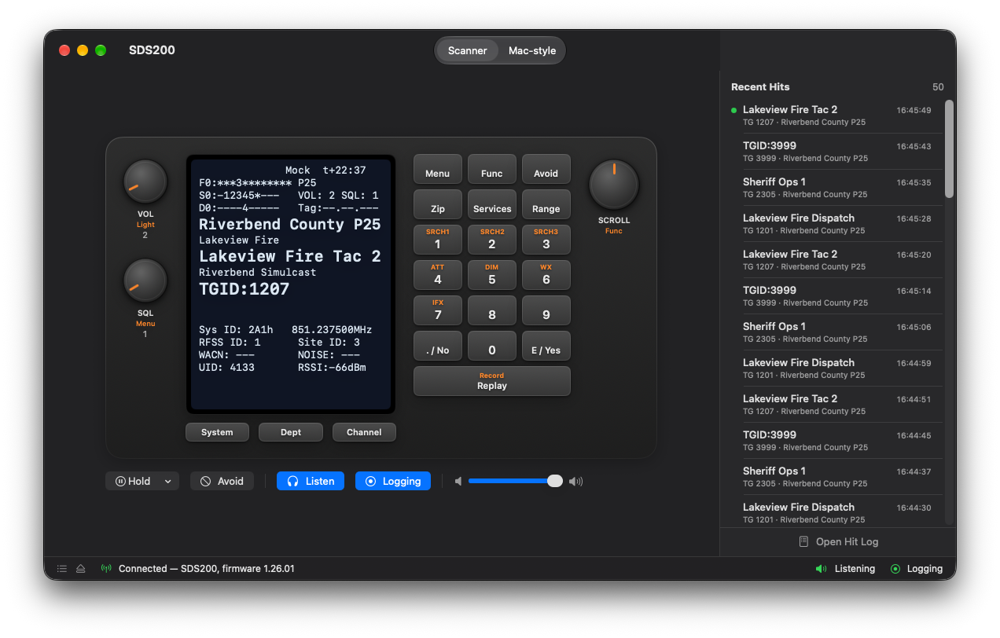
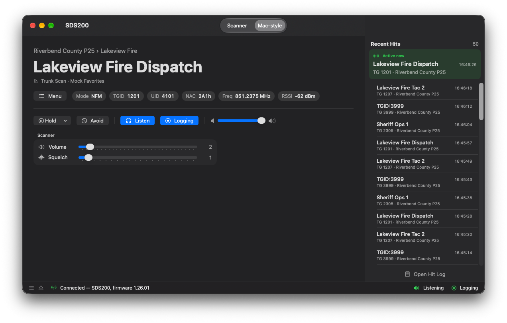
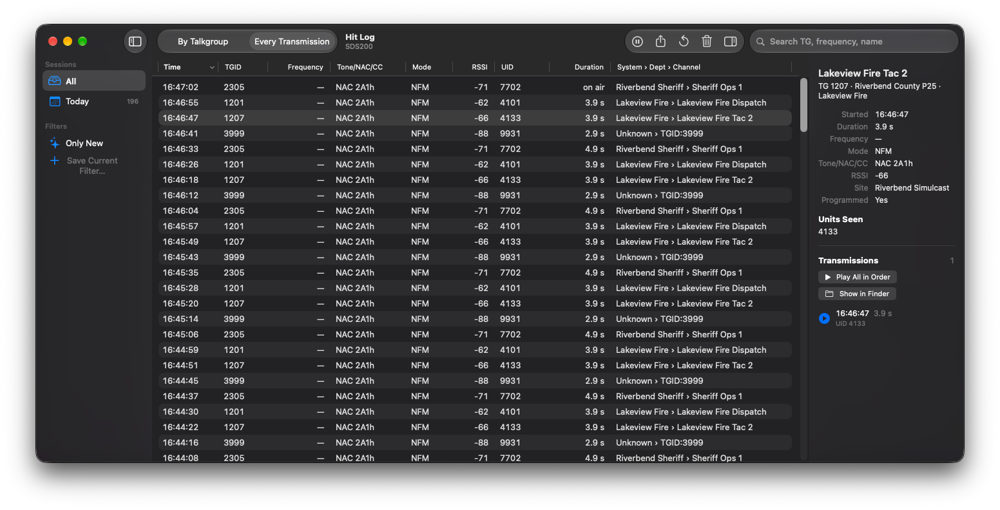

# Noctule Scan

A Mac app and command-line tool for controlling, listening to and logging Uniden SDS-series scanners.

[](https://github.com/noctule-dev/noctule-scan/actions/workflows/ci.yml)
[](LICENSE)
[](https://github.com/noctule-dev/noctule-scan/releases)


## What it does

Noctule Scan connects to a scanner, shows its display, lets you press its keys and menus and set its volume and squelch, plays its audio on the Mac, and logs every transmission (what was heard, when, for how long, with a recording where there is audio). The `noctule` command line does the same without the app. A simulated scanner, `noctule-mock-scanner`, lets you try everything without hardware.

- **Uniden SDS200** over the network: control, audio over RTSP, hit logging, Favorites quick keys.
- **Uniden SDS150 and SDS100** over USB serial: control, hit logging, Favorites quick keys. They have no audio over USB; a cable from the scanner's headphone jack to a Mac audio input gives them recordings, playback and a level meter.







The screenshots show the Noctule Scan brand and aren't covered by the Apache license (see [TRADEMARKS.md](TRADEMARKS.md)).

## Requirements

- macOS 26 or later (`Package.swift` sets `.macOS(.v26)`). The shared libraries also build for iOS 26; the app is macOS only for now, with iPad and iPhone later.
- Xcode 27.2 (Swift 6.4) to build. Earlier Xcode releases can't build the code.
- A Uniden SDS200, SDS150 or SDS100, or none: the mock stands in.

## Quick start (no scanner needed)

If a real USB scanner is plugged in, run `export NOCTULE_NO_USB_DETECTION=1` first, so nothing you run looks for it.

```sh
swift run noctule-mock-scanner                      # prints udp-port=… and rtsp-port=…
swift run noctule info --host 127.0.0.1 --port <udp-port>
scripts/build-app.sh                                # builds "build/Noctule Scan.app"
```

To run the app against the mock without touching your own stations or a real scanner, give it a private `NOCTULE_SETTINGS_DIR` whose only station is the mock; the steps are in [AGENTS.md](AGENTS.md) under "The Mac app". The same file describes the mock scanner and the rules for working near real hardware.

## Unbranded builds

The app icon and the installer background are brand art and aren't in this repository. A local build uses a placeholder icon and a plain installer background. The official signed, notarized release carries the Noctule Scan icon. Forks that distribute their own builds must rename them; see [TRADEMARKS.md](TRADEMARKS.md).

## Downloads

Signed, notarized DMGs are on the [Releases](https://github.com/noctule-dev/noctule-scan/releases) page, once there is one.

## Where to read

- [docs/specs/README.md](docs/specs/README.md): the index of design documents and plans.
- [docs/specs/2026-11-08-sds-remote-protocol.md](docs/specs/2026-11-08-sds-remote-protocol.md): the scanner protocol notes.
- [AGENTS.md](AGENTS.md): how to build, test and work on the code, for people and coding agents alike.

## Contributing

See [CONTRIBUTING.md](CONTRIBUTING.md). Please also read [CODE_OF_CONDUCT.md](CODE_OF_CONDUCT.md) and, for security problems, [SECURITY.md](SECURITY.md).

## License and trademarks

Licensed under the Apache License 2.0; see [LICENSE](LICENSE) and [NOTICE](NOTICE). "Noctule", "Noctule Scan" and the app icons are trademarks of Sean Foley and aren't licensed under it; see [TRADEMARKS.md](TRADEMARKS.md).

## Acknowledgments

See [ACKNOWLEDGMENTS.md](ACKNOWLEDGMENTS.md).

Noctule Scan is not affiliated with or endorsed by Uniden. Uniden, SDS100, SDS150 and SDS200 are trademarks of Uniden.
